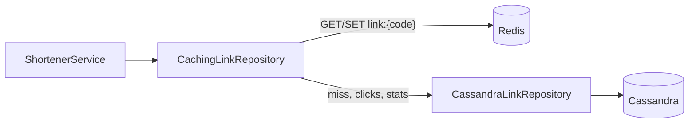
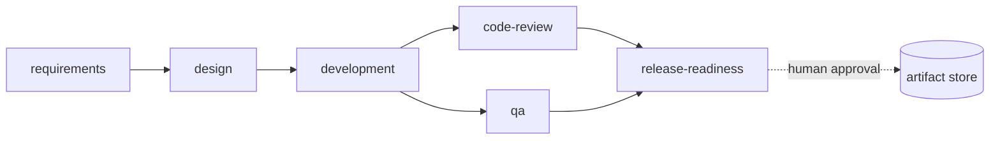

# ascs-url-shortener: Design

## 1. What this is
Two cooperating parts, deliberately decoupled:

* **Orchestrator** (`com.ascs.orchestrator`, Maven module `orchestrator`): the product. It takes a requirement and drives it through a governed SDLC
  (requirements -> design -> implementation -> tests/security/docs -> release) using pluggable agents, with explicit
  dependency graph, gates, policy guardrails, human approvals, retries/fallback/rollback/safe-stop, re-planning,
  audit and metrics.
* **URL shortener** (`com.ascs.shortener`, module `shortener-service`, contract in `shortener-api`): the reference
  system the orchestrator plans and changes, built and deployed as an independent microservice.
  Hexagonal: `domain` (rules) / `app` (use cases) / `infra` (adapters) / `web` (Spring). Only `web` and
  `AscsApplication` depend on Spring.

```
requirement text
   |  RequirementAnalyzer  (classify, flag ambiguity, record assumptions)         [planner]
   v
NormalizedRequirement --> tasks (id, deps, output, impact, approval, retries, ...)
   |  WorkflowPlanner      (1 task = 1 stage; entry/exit gates derived from artifact flow)
   v
WorkflowGraph (validated DAG) --> WorkflowEngine --> agents (pluggable: stub today, LLM later)
                                      |  gates -> policies -> [human approval] -> commit
                                      v
                     ArtifactStore (versioned, lineage)   AuditLog (hash chain)   Metrics
```

## 2. Control flow of one stage
```
deps SUCCEEDED? --no--> wait            any dep FAILED/BLOCKED/REJECTED? --> BLOCKED
   | yes
entry gates --deny--> BLOCKED
   | pass
RUNNING (agent on worker thread; per-attempt timeout)
   | result
exit gates --deny--\
policies:  CRITICAL -> FAILED + SAFE-STOP (never retried)
           BLOCK    -> attempt failed ---> retry (bounded, backoff) -> fallback agent -> FAILED
   | clean                                                          |
requiresApproval? --yes--> AWAITING_APPROVAL --approve--> commit     v
   | no                          |reject/timeout--> REJECTED   failure strategy:
commit artifacts (versioned, lineage) -> SUCCEEDED                  BLOCK_DESCENDANTS | ROLLBACK_RUN | SAFE_STOP
```
Statuses: `PENDING RUNNING AWAITING_APPROVAL SUCCEEDED FAILED BLOCKED REJECTED ROLLED_BACK ROLLBACK_FAILED`.
Run outcomes: `SUCCEEDED FAILED ROLLED_BACK ROLLBACK_INCOMPLETE SAFE_STOPPED ABORTED`.

## 3. Concurrency model (the part that must be right)
One coordinator thread owns all mutable run state. Agents run on workers and see only an immutable `StageInput`.
Agent results, human decisions, change requests and the kill switch all arrive as events on one queue. Consequences:
no locks around run state; a re-plan cannot race a completing stage; stale results (from cancelled or superseded
attempts) are dropped via a per-stage *generation* counter. Parallel branches fan out; multi-dependency stages join
because a stage runs only when **all** deps SUCCEEDED. Stages see only **ancestor** artifacts, so siblings are isolated.

## 4. Requirement -> control map
| Assignment requirement | Where |
|---|---|
| Explicit dependency graph, entry/exit gates | `WorkflowGraph` (cycle/dup/unknown-dep rejection), `Gate` |
| Sequential + parallel paths with synchronization | event-driven fan-out; join on all deps |
| Cross-stage context and decision lineage | `ArtifactStore`: versions + `inputs`; `lineage()` |
| Human approval for high-impact actions | `requiresApproval`; HIGH impact without it is refused at construction; commit only after approval; timeout = reject |
| Bounded retries, fallback | `RetryPolicy(1..10, backoff)`, `fallbackAgent`, per-attempt timeout |
| Rollback | `ROLLBACK_RUN`: reverse-order compensation + artifact revocation; failed compensation escalates (`ROLLBACK_INCOMPLETE`) |
| Safe-stop | kill switch, CRITICAL policy, failure budget, replan budget: freeze, cancel in-flight, commit nothing |
| Policy guardrails: security / compliance / change control | `SecretLeakPolicy`, `RequiredEvidencePolicy`, `ProtectedPathPolicy` + engine-level HIGH-needs-approval rule |
| Audit-grade traceability | hash-chained `AuditLog` (`verify()`); secrets never echoed |
| Reliability metrics | `Metrics`: success rate, retry/rollback rate, MTTR, p50/p95 latency |
| Dynamic re-planning | `submitChange` -> new artifact version -> invalidate only stages that consumed the old one; re-run passes all gates/policies/approvals again |
| Controlled autonomy | agents cannot commit, approve, or change policy; they return values that the engine validates |
| Role agents with SDLC evidence | `orchestrator.agents`: requirements, design, development, code review, QA and release agents in `DeliveryPipeline` (section 8) |
| Error handling, logging, auditing | `ApiExceptionHandler`, `RequestIdFilter`, `System.Logger` in the core, `AuditTrail` port (section 9) |

## 5. Key decisions
| Decision | Rationale | Trade-off |
|---|---|---|
| Own small engine, not a framework | Governance semantics are the product; must be explainable line by line | No durability or UI that mature engines give |
| Single-writer coordinator + event queue | Eliminates a class of races | One run = one coordinator thread |
| Output committed only after gates, policies, approval | Rejected output can never contaminate downstream context | Reviewer sees a proposal, not a diff of a live system |
| CRITICAL policy = safe-stop, not retry | An agent that edits the CI pipeline should be contained, not re-prompted | Needs a human to resume |
| Governance validated at construction | Misconfigured workflow never starts | Stricter API |
| Agents behind an interface; deterministic stubs | Runs offline; behaviour is testable and reproducible | **Stub agents emit templated text, not real engineering output** |
| Rollback = whole-run revert | Simple, auditable semantics | No partial/selective rollback |
| 302 redirects | Every click observable | Slightly more load than cacheable 301 |

## 6. Persistence: Cassandra storage with a Redis cache (built)
`CachingLinkRepository` (Redis, cache-aside) decorates `CassandraLinkRepository` behind the existing `LinkRepository`
port, so the service, controller and validator did not change. `shortener.storage=memory|cassandra` selects the store;
a non-empty `shortener.cache.redis-url` adds the cache. Profile `cassandra` + `docker-compose.yml` run the full stack.



* **Cassandra** (`CassandraSchema`): `links(code PK, original_url, created_at, expires_at)`; create =
  `INSERT ... IF NOT EXISTS`, whose `[applied]` flag is `saveIfAbsent` (the service retries a collision with a new code).
  Clicks are a counter in `link_clicks`; `link_access.last_accessed_at` is written `USING TIMESTAMP` = click time, so
  out-of-order clicks cannot move it backwards. Reads and creates use LOCAL_QUORUM. Rows are kept after expiry
  (stats stay available); expiry is enforced by the service.
* **Redis**: `link:{code}` with TTL = min(remaining life, 24 h); unknown codes are negatively cached for 60 s; a create
  primes the entry. Clicks and stats are never cached (counters must not be stale).
* **Failure modes**: Redis down -> requests read through to Cassandra (one warning per outage, commands rejected fast
  while disconnected, automatic reconnect). Cassandra down -> creates and uncached redirects return 503
  (`StorageUnavailable`); cached redirects still succeed and the click is dropped with a warning (availability over
  exact counts).
* **Not built yet**: buffering clicks with Redis `INCR` and flushing to Cassandra (needed only for very hot links),
  durable audit storage (the audit trail is still in memory), schema migrations for production
  (`shortener.cassandra.create-schema` is a development convenience).

## 7. Known limitations
See `docs/PRODUCTION_READINESS.md` for the full assessment. Headline: everything is in-memory, runs are not durable
or resumable, control-plane operations have no authentication, agents are stubs and run in-process.

## 8. Role agents and the delivery pipeline
`DeliveryPipeline` runs on the same `WorkflowEngine`, so every governance control applies to it:



| Agent | Input | Output | How it works |
|---|---|---|---|
| `RequirementsAgent` | requirement text | `user-stories.md` | Matches the requirement against `StoryCatalog` (stories with Given/When/Then criteria `AC-n.m`); vague words ("faster", "secure") become open questions, never guesses |
| `DesignAgent` | stories, source tree | `design.md` | Builds the Mermaid component diagram from real package references, adds the main sequence diagrams and checks the layering rules (Spring only in `web`, `domain` independent, orchestrator and shortener decoupled) |
| `DevelopmentAgent` | git | `development-report.md` | Audits commit subjects (Conventional Commits, max 72 chars) and groups pending changes into one proposed commit per component |
| `CodeReviewAgent` | every main and test file | `code-review.md` | Rules CR-01..07 (secrets, swallowed errors, printed stack traces, console output, to-do markers, weak randomness, missing Javadoc); waivers must be explicit and reasoned (`review:accepted`); never echoes source lines |
| `QaAgent` | stories, test sources, JaCoCo XML | `qa-report.md` | Unit coverage per package and file with missed line numbers; functional coverage from `@Verifies` on tests; lists every gap against the target |
| `ReleaseReadinessAgent` | review + QA reports | `release-readiness.md` | Recommends READY / READY WITH DOCUMENTED GAPS / NOT READY and cites the exact artifact versions (enforced by `RequiredEvidencePolicy`); HIGH impact, so committed only after human approval |

Agent outputs also pass `SecretLeakPolicy`. The agents are deterministic so runs are reproducible and testable;
`StoryCatalog` and the review rules are the product knowledge an LLM-backed agent would replace.

## 9. Shortener error handling, logging and auditing
* **Errors.** A sealed `ShortenerException` hierarchy maps to 400/404/410/503. Spring MVC errors go through
  `ResponseEntityExceptionHandler`, so they are RFC 7807 too. Anything unexpected becomes a 500 problem with an
  `errorRef`; the stack trace is logged under that id and never sent to the client.
* **Logging.** The framework-free core logs through `System.Logger` (routed to SLF4J/Logback by Spring Boot).
  `RequestIdFilter` gives each request a correlation id (`X-Request-Id`, MDC key `requestId`, part of the log pattern)
  and writes one access-log line. Caller-supplied codes are neutralised before they reach a log line (no log forging),
  and only the target host of a URL is logged, never its query string.
* **Auditing.** The `AuditTrail` port records every create and redirect, successful or rejected
  (`LINK_CREATED`, `LINK_CREATE_REJECTED`, `LINK_REDIRECTED`, `LINK_REDIRECT_REJECTED`). `InMemoryAuditTrail` keeps
  the newest `shortener.audit.capacity` events, and monotonic sequence numbers expose evicted ranges. Exposed at
  `GET /api/v1/links/{code}/audit` and `GET /api/v1/audit?limit=`. The orchestrator keeps its own hash-chained `AuditLog`.
