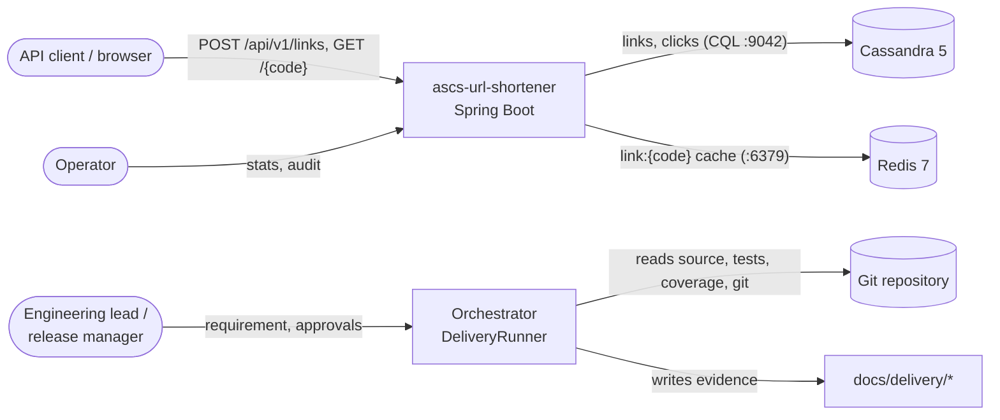
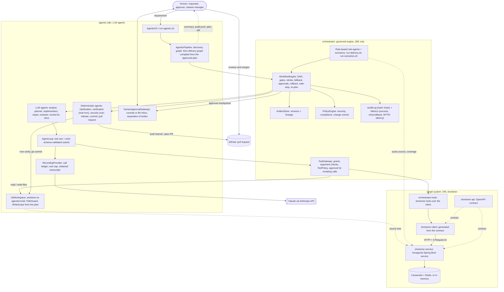
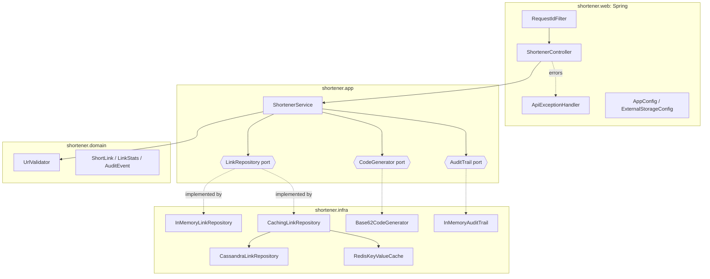
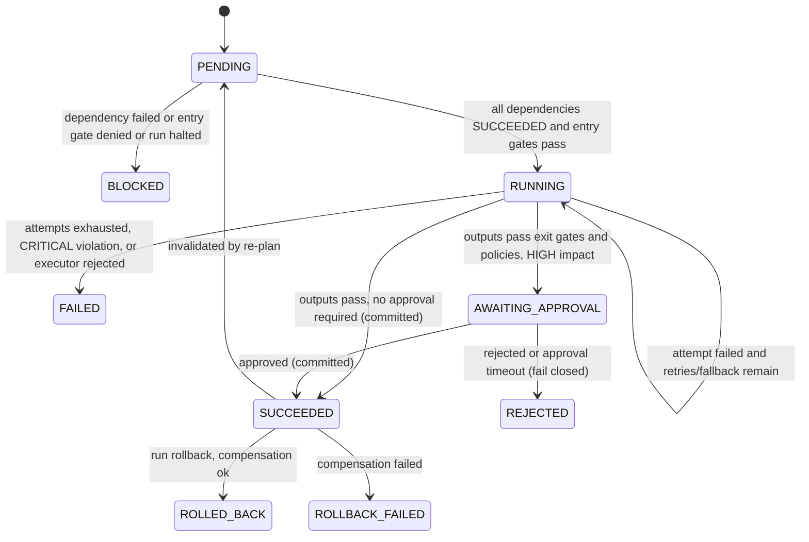
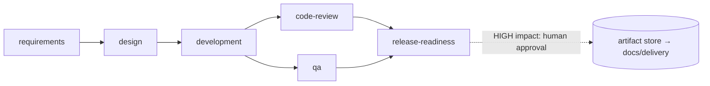
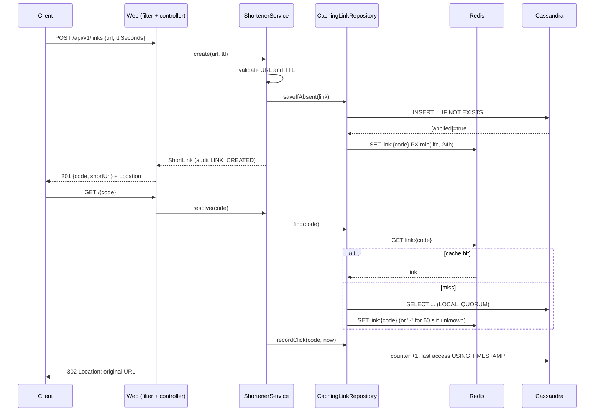
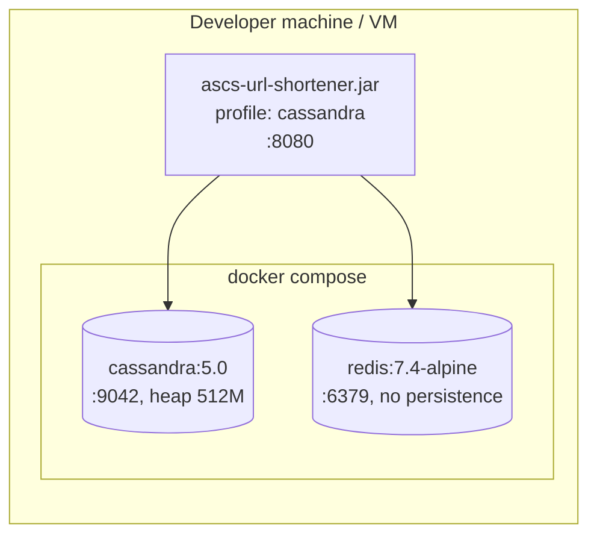

# Technical Design Document: ascs-url-shortener

| | |
|---|---|
| **System** | URL shortener delivered by a governed agentic SDLC orchestrator |
| **Version** | 1.0 |
| **Date** | 2026-10-21 |
| **Status** | Implemented. The Cassandra/Redis path is built but awaits verification on a machine with Docker (section 13). |
| **Stack** | Java 21, Spring Boot 3.3.5, Apache Cassandra 5 (DataStax driver 4.18), Redis 7 (Lettuce 6.3), JUnit 5, JaCoCo, Testcontainers |
| **Companion documents** | `docs/DESIGN.md` (design notes), `docs/delivery/*` (agent-generated evidence), `docs/CODE_REVIEW.md`, `docs/PRODUCTION_READINESS.md` |

---

## 1. Purpose and scope

The system has two parts that are deliberately decoupled:

1. **Agentic SDLC orchestrator.** Turns a requirement into a dependency graph of stages and executes them with *role
   agents* (requirements, design, development, code review, QA, release) under explicit governance: gates, policy
   guardrails, human approval, retries, rollback, safe-stop, re-planning and a tamper-evident audit trail. Agents
   execute; humans approve; the engine enforces.
2. **URL shortener.** The reference product the orchestrator delivers: it creates short codes, redirects, expires
   links, counts clicks and audits every action. Links are stored in Cassandra, and Redis caches the redirect path.

### 1.1 Goals
- Short links: create, redirect (302), optional expiry, click analytics, audit history.
- Durable storage in Cassandra; low-latency redirects served from Redis; graceful degradation when either fails.
- A governed delivery workflow whose controls are *enforced by the engine*, not requested of the agents.
- Evidence for each SDLC role: user stories, design, commit quality, code review, unit and functional coverage.

### 1.2 Non-goals (current release)
- LLM-backed agents inside the `orchestrator` module (its agents stay deterministic and rule-based). The separate
  `agentic-sdlc` module runs Claude agents on the same engine; see `docs/AGENTIC_SETUP.md` for its design and status.
- Authentication, multi-tenancy, rate limiting.
- Durable orchestrator runs and durable audit storage.
- Custom (vanity) short codes, link editing or deletion.

---

## 2. Requirements

### 2.1 Functional requirements
The requirements agent produces the authoritative list: 9 user stories and 39 Given/When/Then acceptance criteria in
`docs/delivery/user-stories.md` (source: `StoryCatalog`). Summary:

| Story | Capability | Key acceptance criteria |
|---|---|---|
| US-1 | Shorten a URL | 201 with code, short URL and Location header; invalid URL or TTL rejected with 400; SSRF targets rejected; 503 when the code space is exhausted |
| US-2 | Redirect | 302 to the original URL; 404 for unknown codes; only successful redirects count a click |
| US-3 | Link expiry | 410 once the TTL has elapsed (boundary inclusive); links without a TTL never expire |
| US-4 | Click analytics | total clicks, created/expiry time, last access; still available after expiry; exact under concurrency |
| US-5 | Audit trail | every create and redirect, successful or rejected, audited; host only, no query strings; per-link history; bounded retention |
| US-6 | Errors and observability | RFC 7807 everywhere; 500 with a reference id and no internals; `X-Request-Id`; no log forging |
| US-7 | Governed agent workflow | dependency order with parallel branches; bounded retries and fallback; human approval for HIGH impact; CRITICAL violation safe-stops the run; rollback in reverse order; tamper-evident audit |
| US-8 | Agentic delivery roles | each role agent produces its evidence |
| US-9 | Durable storage and caching | durable across restarts; one winner for a contested code; served from Redis; cache entry never outlives its link; negative caching; read-through on Redis outage |

### 2.2 Non-functional requirements

| Category | Requirement | How it is met | Status |
|---|---|---|---|
| Performance | Redirects should not read the database for hot links | Redis cache-aside on `link:{code}` | Built; not load-tested |
| Availability | A Redis outage must not break the service | Read-through to Cassandra; fast command rejection while disconnected | Built, unit-tested |
| Availability | A Cassandra outage should keep hot links working | Cached redirects succeed; the click is dropped with a warning; creates return 503 | Built, unit-tested |
| Consistency | A short code maps to exactly one URL forever | Cassandra lightweight transaction (`IF NOT EXISTS`); LOCAL_QUORUM reads | Built; Docker test pending |
| Security | No SSRF or open redirect into internal networks | `UrlValidator`: http(s) only, no credentials, rejects loopback, private, link-local and CGNAT ranges and obfuscated IPs | Built, tested |
| Security | Codes are not guessable | 7 characters from `SecureRandom` over base62 (62^7 ≈ 3.5 × 10^12) | Built |
| Security | No secrets or tokens in logs and audit | Host-only logging; secret-leak policy on agent output; the audit log never echoes secrets | Built, tested |
| Observability | Every request is traceable | `X-Request-Id` in the MDC and the response; access log; `errorRef` on 500s | Built, tested |
| Auditability | Orchestrator decisions are tamper-evident | SHA-256 hash-chained `AuditLog.verify()` | Built, tested |
| Quality | Coverage target 100% | JaCoCo gate: 99% lines and branches, 100% methods; gaps documented | Met except documented gaps |
| Portability | The core runs with only a JDK | Only `web` and the driver adapters need libraries; scripts compile the rest with `javac` | Built |

---

## 3. System context



The orchestrator runs as a command-line process (`scripts/run-delivery.sh`) against the repository. The shortener runs
as a web service. They share a codebase and build, but neither depends on the other at runtime, and an architecture
rule enforces that.

---

## 4. Architecture

### 4.0 End-to-end view

A requirement enters at the top and leaves as a human-approved commit on an isolated branch; the shortener is the
system being changed (its source, in a git worktree) and operated (its running API, through the tool gateway).
Solid arrows are calls, dashed arrows are reads of evidence. The model only proposes: every gate, approval, retry,
fallback and rollback is decided by the engine or a human.



### 4.1 Module decomposition

Six Maven modules. The orchestrator and the shortener have no compile dependency on each other's code; the
shortener's public surface is its OpenAPI contract, published as its own artifact so clients depend on the contract.

| Maven module | Contents | Depends on |
|---|---|---|
| `shortener-api` | `openapi/shortener-v1.yaml` (OpenAPI 3.0) | - |
| `shortener-service` | `com.ascs.AscsApplication`, `com.ascs.shortener.*`; Spring Boot jar | `shortener-api` |
| `shortener-client` | `com.ascs.contract.shortener.*`, generated from `shortener-api` at build time | `shortener-api` |
| `orchestrator` | `com.ascs.orchestrator.*` incl. the tool gateway; plain Java | - (JDK only) |
| `orchestrator-tools` | `com.ascs.orchestrator.tools.shortener.*`: gateway tools over the generated client | `orchestrator`, `shortener-client` |
| `agentic-sdlc` | `com.ascs.agentic.*`: Claude agents, workflow graphs, tool loop, human channels, git worktree; see `docs/AGENTIC_SETUP.md` | `orchestrator`, Anthropic Java SDK |

`ApiContractTest` keeps contract and implementation in step: every documented operation must be implemented, every
endpoint documented, and response bodies must match the documented schemas. The orchestrator treats
`shortener-service` as its target system (`Scenarios.TARGET_SYSTEM`): it reads the module's sources for impact analysis,
review and QA, and calls the running service only through the tool gateway (section 5.7) and the generated client.

```
com.ascs
├── AscsApplication                    Spring Boot entry point            [shortener-service]
├── orchestrator                       (framework-free)                   [orchestrator]
│   ├── model        value types: StageDefinition, RetryPolicy, RunOptions, Gate, RunReport, ...
│   ├── core         WorkflowGraph (DAG), WorkflowEngine (executor), ArtifactStore, Agent
│   ├── policy       SecretLeak, ProtectedPath, RequiredEvidence; PolicyEngine
│   ├── approval     ApprovalGateway port: Scripted, Console
│   ├── audit        hash-chained AuditLog
│   ├── metrics      reliability metrics
│   ├── planner      requirement analysis, task decomposition, DAG planning, codebase impact analysis
│   ├── agents       role agents + DeliveryPipeline + DeliveryRunner
│   ├── scenario     greenfield / brownfield / ambiguous demonstrations
│   └── sdlc         minimal 7-stage demo
└── shortener                          (hexagonal)                        [shortener-service]
    ├── domain       ShortLink, LinkStats, AuditEvent, UrlValidator, ShortenerException
    ├── app          ShortenerService + ports LinkRepository, AuditTrail, CodeGenerator
    ├── infra        Base62CodeGenerator, InMemoryLinkRepository, InMemoryAuditTrail
    │   ├── cache      CachingLinkRepository, KeyValueCache
    │   ├── redis      RedisKeyValueCache (Lettuce)
    │   └── cassandra  CassandraLinkRepository, CassandraSchema (DataStax driver)
    └── web          Spring MVC: controllers (API, contract), error handler, request-id filter, configuration
```

### 4.2 Dependency rules (checked automatically by the design agent)

| Rule | Rationale |
|---|---|
| Only `shortener.web` and `AscsApplication` use Spring | The domain and use cases stay framework-free and fast to test |
| `shortener.domain` depends on no other shortener package | The business rules have no dependencies |
| `shortener.app` depends only on `shortener.domain` | Use cases talk to infrastructure only through ports |
| The orchestrator does not depend on the shortener, and vice versa | Either can evolve and be deployed independently; also enforced by the Maven module graph |
| Only `infra.cassandra`/`infra.redis` need driver libraries | The scripts compile the rest with a plain JDK |

Current result: all five rules pass (`docs/delivery/design.md`, section 4).

### 4.3 Component view



---

## 5. Orchestrator design

### 5.1 Concepts
- **Stage**: a node of the DAG with dependencies, entry gates (preconditions on stored artifacts), exit gates
  (conditions on the agent's proposed outputs), retry policy, optional fallback agent, impact (LOW or HIGH), approval
  flag, optional compensating rollback action, and a failure strategy (`BLOCK_DESCENDANTS`, `ROLLBACK_RUN`, `SAFE_STOP`).
- **Agent**: `AgentResult execute(StageInput)`. It sees only an immutable snapshot of *ancestor* artifacts and returns
  outputs. It cannot commit, approve or change policy.
- **Artifact**: a versioned named output (`design.md@2`) with a SHA-256 hash and its exact inputs (lineage).

### 5.2 Concurrency model
One **coordinator thread** owns all run state. Agents run on a worker pool. Every asynchronous input (agent result,
human decision, change request, kill switch) is an event on one queue that the coordinator consumes, so there are
no locks around run state and no races between, say, a re-plan and a completing stage. Each stage has a **generation
counter**; results or decisions from a cancelled or superseded attempt carry an old generation and are discarded
(`STAGE_RESULT_DISCARDED`).

### 5.3 Stage lifecycle



Run outcomes: `SUCCEEDED`, `FAILED`, `ROLLED_BACK`, `ROLLBACK_INCOMPLETE`, `SAFE_STOPPED`, `ABORTED`.

### 5.4 Governance controls

| Control | Mechanism | Default |
|---|---|---|
| Commit ordering | exit gates → policies → (approval) → commit; rejected output never reaches later stages | always |
| Policy severity | INFO/WARN recorded (WARN shown to the approver); BLOCK fails the attempt (retryable); CRITICAL fails the stage and safe-stops the run without retrying | always |
| Change control | A HIGH-impact stage without required approval is refused when the engine is built; agent patches touching `.github/`, `deploy/`, `application-prod`, `Jenkinsfile`, `.gitlab-ci` are CRITICAL | always |
| Retries | 1..10 attempts, linear backoff ≤ 5 min, then the fallback agent | per stage |
| Timeouts | agent attempt 10 min, approval 30 min, compensation 30 s | `RunOptions.defaults()` |
| Budgets | 3 re-plans per run; failure budget (0 = unlimited) | `RunOptions` |
| Rollback | compensations run in reverse topological order; a failure escalates to `ROLLBACK_INCOMPLETE` | per stage |
| Re-plan | `submitChange` creates a new artifact version and invalidates only stages that consumed the old version; re-runs pass every gate, policy and approval again | on demand |
| Kill switch | `requestSafeStop`: freeze, cancel in-flight work, commit nothing more | on demand |

### 5.5 Audit and metrics
`AuditLog` events (29 types) are appended with `hash = SHA-256(seq, time, run, stage, type, detail, prevHash)`.
`verify()` detects edits, deletions and reordering. Messages never contain offending content (secrets are reported by
kind and location only). `Metrics` reports success, retry and rollback rates, MTTR and p50/p95 run latency.

### 5.6 Role agents and the delivery pipeline



| Agent | Inputs | Output | Logic |
|---|---|---|---|
| `RequirementsAgent` | requirement text | `user-stories.md` | Selects stories from `StoryCatalog` by keyword; vague words become open questions |
| `DesignAgent` | stories, source tree | `design.md` | Mermaid package diagram from real references, sequence diagrams, 5 architecture rules, traceability |
| `DevelopmentAgent` | `git log`, `git status` | `development-report.md` | Conventional Commits and a 72-character check; one proposed commit per component |
| `CodeReviewAgent` | every `.java` file | `code-review.md` | Rules CR-01..07 (secrets, empty catch, printed stack traces, console output, to-do markers, `java.util.Random`, missing Javadoc); reasoned `review:accepted` waivers; approved if no open HIGH/MEDIUM finding |
| `QaAgent` | stories, tests, JaCoCo XML, surefire XML | `qa-report.md` | Coverage per package/file with missed lines; acceptance criteria → tests that **ran and passed** (`@Verifies`); every gap |
| `ReleaseReadinessAgent` | review and QA reports | `release-readiness.md` | READY / READY WITH DOCUMENTED GAPS / NOT READY; cites exact versions (enforced by policy) |

Pipeline policies: `SecretLeakPolicy` on all outputs; `RequiredEvidencePolicy` requires the release summary to cite
`code-review.md@n` and `qa-report.md@n`.

### 5.7 Tool gateway: agents calling external APIs

Agents only return values, so an agent that needs a live system works through tools: a `ToolUsingAgent` loops
*planner -> gateway -> planner* (bounded by `maxSteps`) and returns its outputs to the engine like any agent. The
`ToolPlanner` is where an LLM plugs in; it only proposes `ToolCall`s. The `ToolGateway` decides, fail closed:

```
planner (LLM or script) --proposes ToolCall--> ToolGateway --HTTP + X-Request-Id--> shortener-service
                                                   |  1. run not revoked, call budget left
                                                   |  2. tool exists and is granted to this stage
                                                   |  3. arguments fit the tool's spec
                                                   |  4. policies (secret leak always on; BLOCK / CRITICAL)
                                                   |  5. MUTATING -> human approval (reject / timeout = deny)
                                                   |  6. execute; read-only retried on 5xx/unreachable, mutating never
                                                   |  7. output truncated, withheld if it looks like a credential,
                                                   v     framed as untrusted data for the model
                                       hash-chained AuditLog (tool, argument names, outcome; never values)
```

| Control | Behaviour |
|---|---|
| Least privilege | Tools are granted per stage; the planner is shown only its stage's tools, and an ungranted call is denied |
| Validation | Unknown arguments, missing required ones and wrong types (integer, boolean) are denied before any I/O |
| Policies | `ToolPolicy` over the call; `SecretLeakPolicy` on arguments is always on. BLOCK denies; CRITICAL denies and revokes tool access for the rest of the run |
| Human approval | `Risk.MUTATING` calls go through the same `ApprovalGateway` as stages (the human sees the full call); rejection, timeout or a failing channel denies |
| Retries | Read-only calls retry on 5xx/unreachable (default 2 attempts); mutating calls are never retried, because the service has no idempotency keys yet |
| Budget | At most N calls per run (default 50), against planner loops |
| Output handling | Truncated (default 8,000 chars), withheld when it looks like a credential, and framed by `ToolResult.forModel()` as untrusted data (prompt-injection defence) |
| Traceability | Correlation id `run.stage.a<attempt>.c<n>` sent as `X-Request-Id`; the service puts it on every log line of the request |
| Audit | `TOOL_CALL_REQUESTED/DENIED/RETRY/SUCCEEDED/FAILED` plus `APPROVAL_*`, with tool name, argument names and outcome, never values |

**Tools from the contract.** `ShortenerContract` reads `openapi/shortener-v1.yaml` from the `shortener-api` jar:
tool name = `operationId`, description = summary + description, parameters from path/query parameters and the JSON
request body (the gateway-owned `X-Request-Id` header excluded), risk from the HTTP method (GET read-only, anything
else mutating). `ShortenerTools` binds a curated subset to the generated client and refuses to start if a binding's
arguments differ from the contract's, so a contract change fails fast instead of being silently dropped. HTTP errors
(4xx) are answers for the planner; I/O failures and 5xx are transient.

---

## 6. URL shortener design

### 6.1 Domain model

| Type | Fields | Notes |
|---|---|---|
| `ShortLink` | code, originalUrl, createdAt, expiresAt (nullable) | immutable; expired when `now ≥ expiresAt` |
| `LinkStats` | code, originalUrl, totalClicks, createdAt, expiresAt, lastAccessedAt | read model |
| `AuditEvent` | seq, at, action, code (nullable), detail | actions: `LINK_CREATED`, `LINK_CREATE_REJECTED`, `LINK_REDIRECTED`, `LINK_REDIRECT_REJECTED` |
| `ShortenerException` (sealed) | `InvalidRequest`, `NotFound`, `Expired`, `CodeExhausted`, `StorageUnavailable` | each maps to one HTTP status |

### 6.2 Use cases (`ShortenerService`)

**Create**
1. Validate the URL (6.3) and the TTL (`0 < ttl ≤ 365 days`, or none).
2. `now` = clock truncated to milliseconds (the precision every store keeps).
3. Up to 5 times: generate a code, `saveIfAbsent`. The first success wins.
4. On success, audit `LINK_CREATED` (host and expiry only) and log. Any domain failure is audited as
   `LINK_CREATE_REJECTED`; `CodeExhausted` and `StorageUnavailable` are logged as warnings.

**Resolve (redirect)**
1. A code outside `[0-9A-Za-z]{4,16}` is a 404, and is never stored as a link code in the audit trail.
2. Look up the link (cache, then store). If expired → 410.
3. Record the click. If storage is unavailable the click is dropped with a warning and the redirect still succeeds.
4. Audit `LINK_REDIRECTED`. Every rejection is audited as `LINK_REDIRECT_REJECTED`.

**Stats** are available even after expiry. **Audit** returns per-link history (404 for unknown codes, so it cannot be used
to probe codes) or the most recent N events (1..1000).

### 6.3 URL validation (SSRF guard)
Trimmed and at most 2048 characters; scheme `http` or `https`; no user-info (credentials); a host is required.
Rejected hosts: `localhost`, `*.localhost`, `*.local`, `*.internal`, `*.localdomain`, IPv6 literals, IPv4 in
0/8, 10/8, 127/8, 169.254/16 (cloud metadata), 172.16/12, 192.168/16, 100.64/10 (CGNAT), 224/4 and above, and
non-dotted-quad numeric forms (`2130706433`, `0x7f.1`, `127.1`). DNS is not resolved, so DNS rebinding is out of
scope (section 13).

### 6.4 Short-code generation
`Base62CodeGenerator`: 7 characters drawn from `SecureRandom`, so 62^7 ≈ 3.52 × 10^12 codes. With *N* stored links
the chance that one candidate collides is about N / 3.5 × 10^12 (1 in 3,500 at a billion links), so five attempts
make `CodeExhausted` (503) practically unreachable while still bounding the work. Uniqueness is enforced by the
store's atomic `saveIfAbsent`, not by the generator.

### 6.5 Sequence: create and redirect



---

## 7. Data design

### 7.1 Cassandra (keyspace `shortener`, created by `CassandraSchema` in development)

```sql
CREATE TABLE links       (code text PRIMARY KEY, original_url text, created_at timestamp, expires_at timestamp);
CREATE TABLE link_clicks (code text PRIMARY KEY, total counter);
CREATE TABLE link_access (code text PRIMARY KEY, last_accessed_at timestamp);
```

| Operation | CQL | Consistency | Notes |
|---|---|---|---|
| create | `INSERT INTO links ... IF NOT EXISTS` | LOCAL_QUORUM (Paxos) | `wasApplied()` is the `saveIfAbsent` result |
| find | `SELECT ... FROM links WHERE code = ?` | LOCAL_QUORUM | visible right after creation |
| click | `UPDATE link_clicks SET total = total + 1` | default | counters cannot share a table with regular columns |
| last access | `UPDATE link_access USING TIMESTAMP <click µs> SET last_accessed_at = ?` | default | the newest click wins regardless of arrival order |
| stats | three single-partition reads | mixed | |

Every access is a single-partition lookup by `code`, so the design scales horizontally. Rows are kept after expiry so
stats stay available. Expiry is a service rule, not a Cassandra TTL.

### 7.2 Redis

| Key | Value | TTL |
|---|---|---|
| `link:{code}` | `createdAtMillis \t expiresAtMillis-or-empty \t url` (a valid URL cannot contain a tab) | min(remaining life, 24 h) |
| `link:{code}` (unknown code) | `-` | 60 s |

A create primes the entry (overwriting any negative entry). Clicks and stats are never cached. Redis runs without
persistence: it is a pure cache.

### 7.3 In-memory (default profile and tests)
`InMemoryLinkRepository` (`ConcurrentHashMap`, `LongAdder` clicks, monotonic last access) and `InMemoryAuditTrail`
(ring buffer, newest 10,000 events, gaps visible through sequence numbers).

---

## 8. API specification

Base path: the service root. JSON everywhere; errors are `application/problem+json` (RFC 7807).

| Method | Path | Request | Success | Errors |
|---|---|---|---|---|
| POST | `/api/v1/links` | `{"url": string, "ttlSeconds": long?}` | 201 `{code, shortUrl, originalUrl, createdAt, expiresAt}` + `Location` | 400 invalid URL/TTL/body, 503 code space exhausted or storage unavailable |
| GET | `/{code}` | n/a | 302 `Location: originalUrl` | 404 unknown, 410 expired, 503 storage unavailable |
| GET | `/api/v1/links/{code}/stats` | n/a | 200 `{code, originalUrl, totalClicks, createdAt, expiresAt, lastAccessedAt}` | 404 |
| GET | `/api/v1/links/{code}/audit` | n/a | 200 `[AuditEvent]` | 404 |
| GET | `/api/v1/audit?limit=1..1000` | n/a | 200 `[AuditEvent]` (default 100) | 400 bad limit |

Example:
```http
POST /api/v1/links
{"url":"https://example.com/docs","ttlSeconds":3600}

201 Created
Location: http://localhost:8080/aZ3k9Qx
X-Request-Id: 6f1c...
{"code":"aZ3k9Qx","shortUrl":"http://localhost:8080/aZ3k9Qx","originalUrl":"https://example.com/docs",
 "createdAt":"2026-10-21T10:00:00Z","expiresAt":"2026-10-21T11:00:00Z"}
```
Error example: `{"type":"about:blank","title":"Gone","status":410,"detail":"link 'aZ3k9Qx' has expired"}`.
Unexpected failures: `500 {"detail":"unexpected error; quote reference <uuid>","errorRef":"<uuid>"}`.

302 rather than 301 is deliberate: browsers must not cache the redirect, or clicks would go uncounted.

---

## 9. Cross-cutting concerns

### 9.1 Error handling
The sealed domain exceptions map to statuses in `ApiExceptionHandler`. Spring MVC errors (malformed JSON, unknown
route, wrong method) are handled by `ResponseEntityExceptionHandler`, so they are RFC 7807 too. Everything else becomes
a 500 with an `errorRef`, and the stack trace is logged under that id. Cassandra driver exceptions are translated to
`StorageUnavailable` inside the adapter, so the web layer never sees driver types.

### 9.2 Logging
- The core uses `System.Logger` (no framework dependency); Spring Boot routes it to SLF4J/Logback.
- `RequestIdFilter`: reuses a safe incoming `X-Request-Id` (`[A-Za-z0-9._-]{1,64}`) or generates a UUID; puts it in the
  MDC (part of every log line) and in the response; writes one access-log line per request.
- Hygiene: URLs are logged by host only; caller-supplied codes are neutralised and truncated before being logged.
- The cache logs one warning per Redis outage and one info line on recovery (no log flood).

### 9.3 Auditing
Two separate trails, for two purposes:
- **Business audit** (shortener): `AuditTrail` port, every create and redirect outcome, exposed through the API.
- **Governance audit** (orchestrator): hash-chained `AuditLog`, every stage, policy, approval, re-plan and rollback.

### 9.4 Security

| Threat | Mitigation | Status |
|---|---|---|
| SSRF / redirect into intranet | `UrlValidator` (6.3) | Built |
| Code enumeration | 62^7 random codes from `SecureRandom`; negative cache limits store load | Built (no rate limit) |
| Log forging | request-id allowlist; neutralised codes | Built |
| Leaking internals | 500 carries only `errorRef` | Built |
| Token leakage through logs and audit | host-only recording | Built |
| CQL injection through configuration | keyspace must be a plain identifier | Built |
| Agent output containing secrets | `SecretLeakPolicy` (BLOCK) | Built |
| Agent changing CI/deploy files | `ProtectedPathPolicy` (CRITICAL → safe-stop) | Built |
| Unauthenticated audit and stats endpoints, approvals, kill switch | none | **Open** |
| DNS rebinding | none | **Open** |

### 9.5 Configuration

| Property | Default | Meaning |
|---|---|---|
| `server.port` | 8080 | HTTP port |
| `shortener.base-url` | `http://localhost:${server.port}` (env `SHORTENER_BASE_URL`) | prefix of short URLs |
| `shortener.storage` | `memory` | `memory` or `cassandra` |
| `shortener.cache.redis-url` | empty (no cache) | e.g. `redis://localhost:6379` (env `REDIS_URL`) |
| `shortener.cache.command-timeout` | 200ms | Redis command timeout |
| `spring.cassandra.contact-points` | `localhost:9042` (env `CASSANDRA_CONTACT_POINTS`) | Cassandra nodes |
| `spring.cassandra.local-datacenter` | `datacenter1` (env `CASSANDRA_DC`) | local DC |
| `shortener.cassandra.keyspace` | `shortener` | keyspace |
| `shortener.cassandra.replication-factor` | 1 | SimpleStrategy RF (development) |
| `shortener.cassandra.create-schema` | true | create keyspace and tables at startup (development) |
| `shortener.audit.capacity` | 10000 | in-memory audit events kept |

---

## 10. Deployment view



| Mode | Command | Infrastructure |
|---|---|---|
| In-memory | `mvn install -DskipTests`, then `mvn -pl shortener-service spring-boot:run` | none |
| Full stack | `docker compose up -d --wait`, then `mvn -pl shortener-service spring-boot:run -Dspring-boot.run.profiles=cassandra` | Docker |
| Validation | `./scripts/validate-all.sh [--cassandra]` (service on port 18080) | JDK + Maven (+ Docker) |
| Agents only | `./scripts/run-delivery.sh` | JDK |

Production would additionally need a container image, health and readiness probes, a multi-node Cassandra cluster
with NetworkTopologyStrategy and migrations, and managed Redis (section 13).

---

## 11. Failure modes

| Failure | Behaviour | Verified by |
|---|---|---|
| Redis down or slow | commands rejected fast; reads go to Cassandra; one warning; automatic reconnect | `CachingLinkRepositoryTest` |
| Cassandra down | creates and uncached redirects → 503; cached redirects → 302, click dropped with a warning | `StorageOutageTest`, `ApiErrorHandlingTest` |
| Concurrent creates of one code | exactly one applied; the loser retries with a new code | `CassandraStorageTest`, `RedisCacheTest` (Docker) |
| Code space exhausted | 503 after 5 attempts; audited | `ShortenerServiceTest` |
| Out-of-order clicks | last access never moves backwards | in-memory and Cassandra tests |
| Agent crash, hang, bad output | retry → fallback → stage fails; timeout cancels | `ResilienceTest` |
| Agent leaks a secret | BLOCK; retried; never committed or logged | `PolicyGuardrailTest` |
| Downstream stage fails (ROLLBACK_RUN) | compensations in reverse order; failures escalate | `RollbackSafeStopTest` |
| Coordinator interrupted | ABORTED; running work cancelled | `EngineEdgeCaseTest` |
| Approver silent | approval times out and the stage is rejected (fail closed) | `ResilienceTest` |

---

## 12. Testing and quality strategy

| Level | Scope | Tools |
|---|---|---|
| Unit | domain, service, engine, policies, agents, cache decorator | JUnit 5, fixtures and hand-written fakes (no mocking library: Mockito's Byte Buddy does not support JDK 25) |
| Concurrency | real threads, latches, barriers (parallel stages provably overlap; 2,000 concurrent clicks) | JUnit 5 |
| Web | full context (`ShortenerApiTest`), web slice with stub service (`ApiErrorHandlingTest`) | Spring Boot Test, MockMvc |
| Integration | real Cassandra 5 and Redis 7, plus the API on the `cassandra` wiring | Testcontainers (skipped without Docker) |
| End to end | 14 HTTP checks against a running service | `scripts/smoke-test.sh` |
| Functional coverage | each acceptance criterion traced to tests that ran and passed | `@Verifies` + `QaAgent` |
| Gates | JaCoCo ≥ 99% lines and branches, 100% methods (driver adapters excluded, covered by Testcontainers); code review approved | `mvn verify`, `CodeReviewAgent` |

Current results: 163 tests pass (6 Docker tests skipped on machines without Docker); 99.9% line and branch coverage
outside the driver adapters; 37 of 39 acceptance criteria verified by passing tests (AC-9.1 and AC-9.2 need Docker).

---

## 13. Key design decisions

| # | Decision | Alternatives | Rationale | Trade-off |
|---|---|---|---|---|
| D1 | Own small workflow engine | Temporal, Camunda, LangGraph | Governance semantics are the product and must be explainable line by line | No durability or UI that mature engines offer |
| D2 | Single-writer coordinator + event queue | Locks around shared state | Removes a whole class of races | One coordinator thread per run |
| D3 | Commit only after gates, policies and approval | Commit, then review | Rejected output can never contaminate downstream context | The reviewer sees a proposal, not a live system |
| D4 | Deterministic agents behind `Agent`; LLM agents in a separate module (`agentic-sdlc`) on the same interface | LLM agents in the engine module | Engine stays dependency-free, reproducible and testable offline; the model only proposes, the engine decides | Two agent families to maintain; LLM runs are not reproducible |
| D5 | Hexagonal shortener with ports | Spring-centric layering | Core testable without Spring; storage swappable | More types |
| D6 | Cassandra for links | Relational DB | Key-value access by code, linear write scaling, multi-DC | Uniqueness needs LWT (Paxos) on create |
| D7 | Redis cache-aside, not the system of record | Redis as the primary store | A cache failure must never lose data | Possible stale entries until TTL (links are immutable, so harmless) |
| D8 | 302 redirects | 301 | Every click is observable | More traffic than cacheable 301s |
| D9 | Availability over exact click counts | Fail redirect when the click write fails | A redirect is the core promise | Clicks may be undercounted during a Cassandra outage |
| D10 | Expiry enforced by the service, not Cassandra TTL | Row TTL | Stats remain available after expiry | Rows are kept indefinitely (needs a retention policy) |

---

## 14. Limitations, risks and roadmap

| Area | Gap | Proposed next step |
|---|---|---|
| Verification | Docker-backed storage tests run in CI (GitHub-hosted runners have Docker) but are skipped on machines without it | Run them against a shared staging Cassandra/Redis too |
| AI | `agentic-sdlc` LLM agents ran live through review (`docs/live-runs/`) but no live run has reached release yet; the tool-gateway planner is rule-based | Complete live greenfield/brownfield/ambiguous runs; an evaluation harness; an LLM `ToolPlanner` |
| Tools | Mutating calls are not idempotent, so never retried | `Idempotency-Key` header in the contract and the service; the gateway derives it from the correlation id |
| Tools | Gateway is in-process, service calls unauthenticated | Service credentials held by the gateway only (OAuth client credentials), scopes per tool |
| Security | No authentication or rate limiting; audit endpoints open | API keys or OAuth, per-client rate limits, admin-only audit |
| Data | Business audit trail in memory | Cassandra audit table partitioned by (code, day) |
| Data | Schema created at startup; RF 1 | Migrations; NetworkTopologyStrategy; retention for expired links |
| Scale | Each click is a Cassandra counter write | Redis `INCR` buffering flushed periodically for hot links |
| Orchestrator | Runs are not durable; approvals unauthenticated | Event-sourced run store; signed, authenticated approvals |
| Operations | No container image, probes, metrics export, JSON logs | Dockerfile, Actuator health, OpenTelemetry, log shipping |
| Security | DNS rebinding not covered | Resolve and pin the IP at create and redirect time |

---

## 15. Glossary

| Term | Meaning |
|---|---|
| Stage | A unit of work in the workflow DAG, executed by one agent |
| Gate | A side-effect-free check before a stage starts (entry) or before its output commits (exit) |
| Policy | A check of proposed output by category (security, compliance, change control) and severity |
| Re-plan | Invalidating and re-running only the stages that consumed a superseded artifact |
| Safe-stop | Freezing a run: cancel in-flight work, commit nothing more |
| LWT | Cassandra lightweight transaction (`IF NOT EXISTS`, Paxos-based compare-and-set) |
| Cache-aside | The application reads the cache, falls back to the store, and fills the cache |
| Negative caching | Caching "not found" briefly so repeated misses do not reach the store |
| RFC 7807 | Standard JSON format for HTTP error responses ("problem details") |
| Acceptance criterion (AC-n.m) | A testable Given/When/Then condition of a user story |
