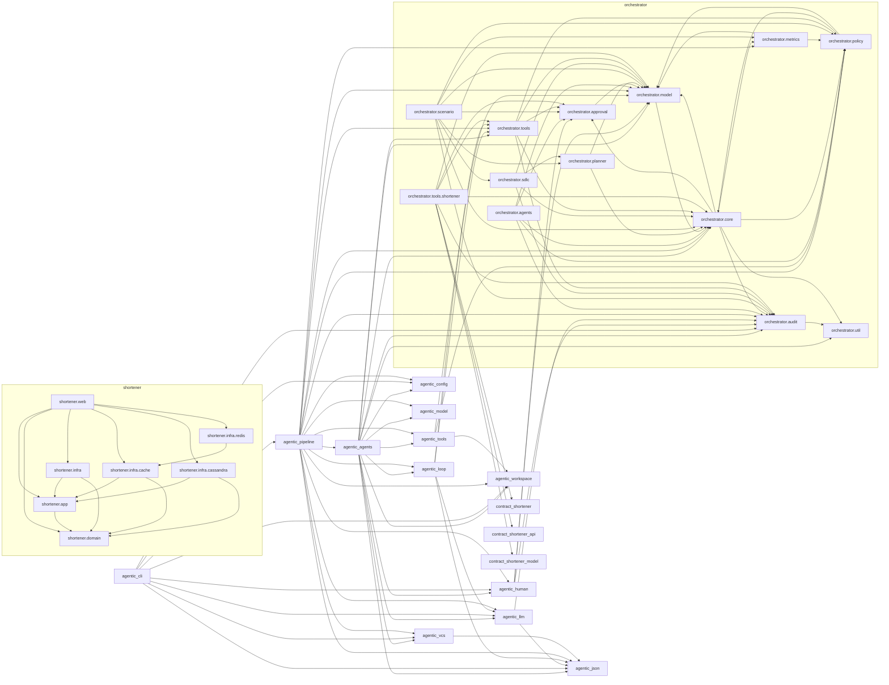
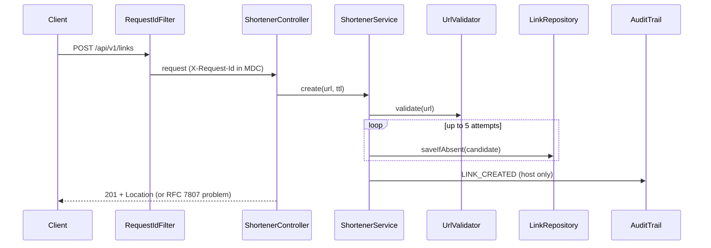
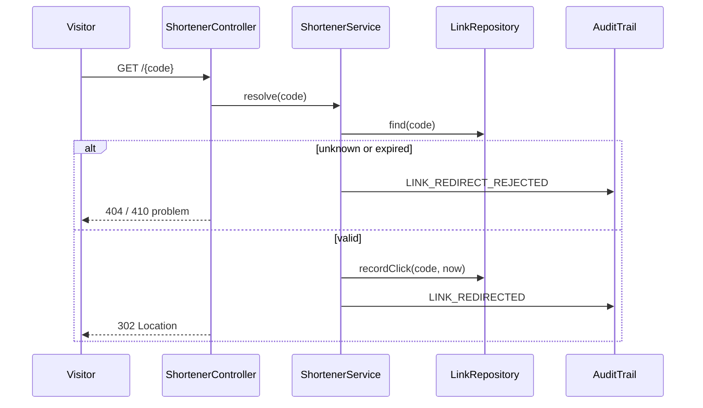
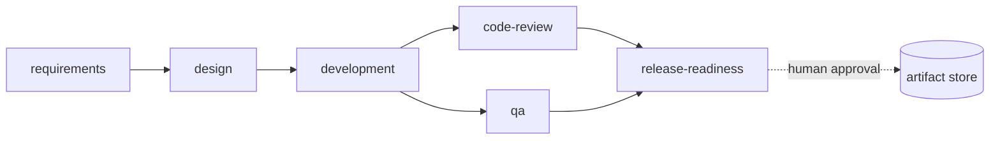

# Design

Generated by `DesignAgent` from the user stories and the source tree (149 main source files, 33 packages).

## 1. Context

Two decoupled parts, built as separate modules with no compile dependency between them. The **URL shortener** (`shortener-service`) is a microservice whose only public surface is its OpenAPI contract (`shortener-api`); inside it is hexagonal: `domain` (rules) <- `app` (use cases and ports) <- `infra` (adapters) and `web` (Spring MVC). The **orchestrator** (`orchestrator`, plain Java) drives role agents through a governed SDLC graph: gates, policies, human approval before commit, retries, rollback, hash-chained audit.

## 2. Component diagram (derived from package references)

## 3. Main flows

### Create a short link (US-1, US-5, US-6)

### Redirect (US-2, US-3, US-4)

### Governed delivery pipeline (US-7, US-8)

## 4. Architecture conformance

| Rule | Result |
|---|---|
| Only `shortener.web` and the application class use Spring | PASS |
| `shortener.domain` depends on no other shortener package | PASS |
| `shortener.app` depends only on `shortener.domain` | PASS |
| Orchestrator does not depend on the shortener | PASS |
| Shortener does not depend on the orchestrator | PASS |

## 5. Traceability (story -> components)

| Story | Components |
|---|---|
| US-1 Shorten a URL | `shortener.web`, `shortener.app`, `shortener.domain`, `shortener.infra` |
| US-2 Redirect | `shortener.web`, `shortener.app` |
| US-3 Link expiry | `shortener.domain`, `shortener.app` |
| US-4 Click analytics | `shortener.web`, `shortener.app`, `shortener.infra` |
| US-5 Audit trail | `shortener.app`, `shortener.infra`, `shortener.web` |
| US-6 Errors and observability | `shortener.web`, `shortener.domain` |
| US-7 Governed agent workflow | `orchestrator.core`, `orchestrator.policy`, `orchestrator.approval`, `orchestrator.audit` |
| US-8 Agentic delivery roles | `orchestrator.agents` |
| US-9 Durable storage and caching | `shortener.infra.cassandra`, `shortener.infra.redis`, `shortener.infra.cache` |
| US-10 Published API contract | `shortener.web` |
| US-11 Governed tool access | `orchestrator.tools` |
